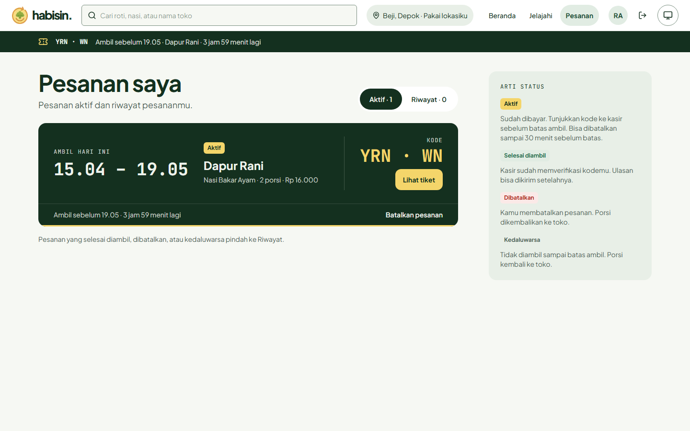
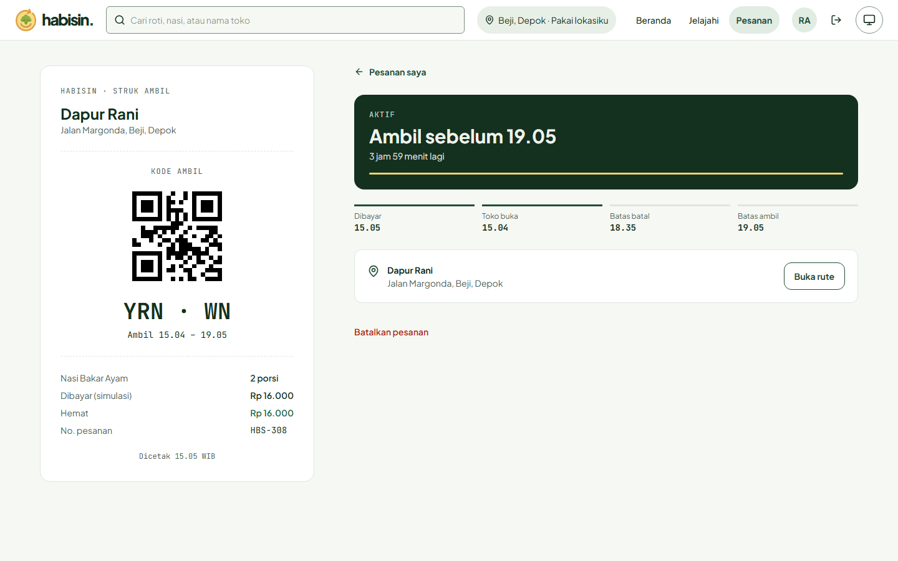
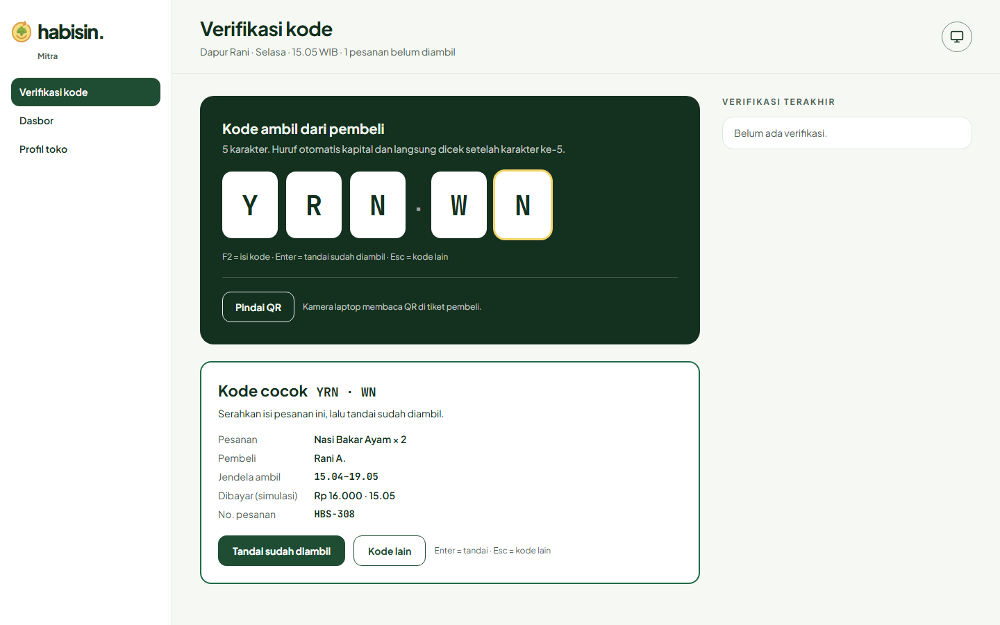
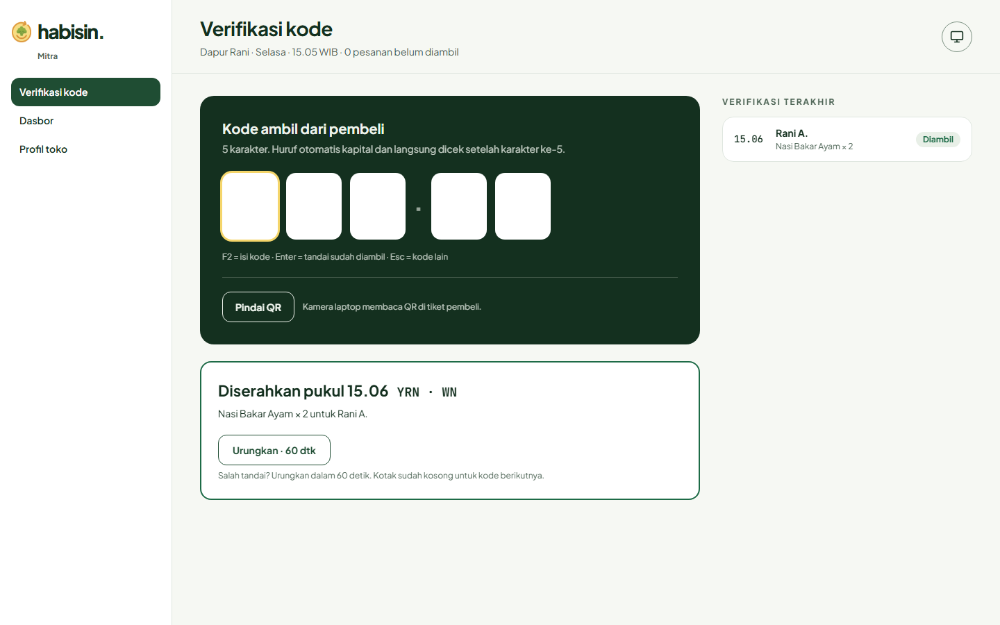
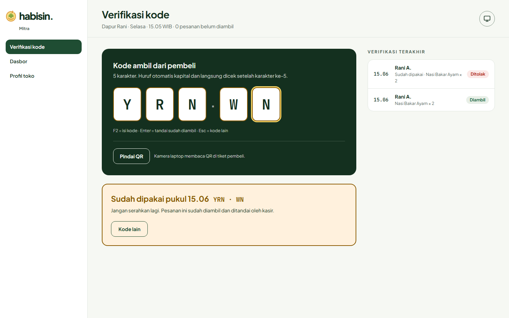
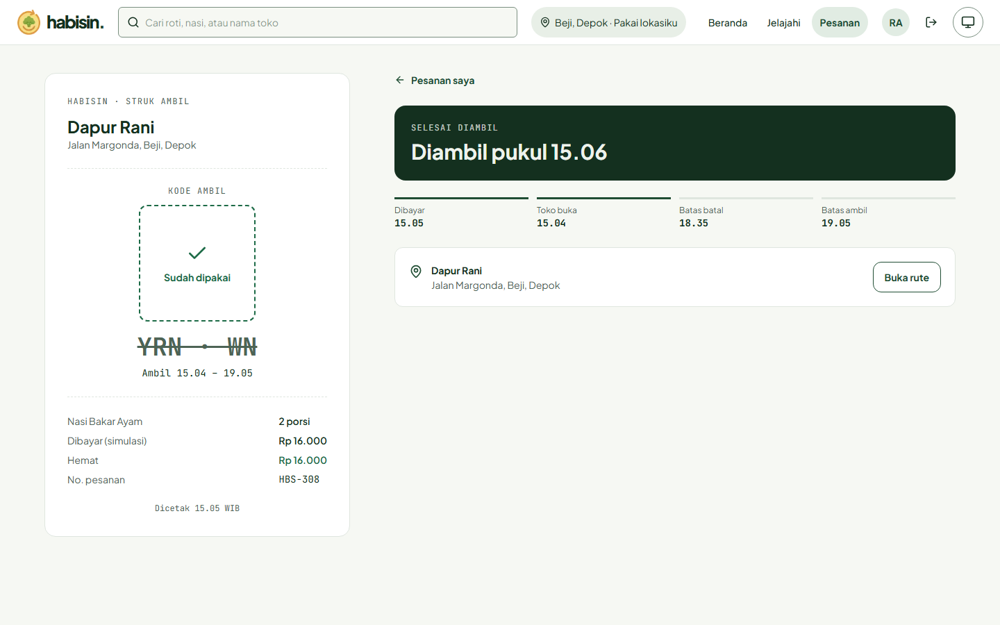

# HABISIN

[](https://github.com/HabisinID/habisin/actions/workflows/ci.yml)

> **Save Food, Cut Waste, Feed Communities.**

Web app berbasis peta interaktif (map-first progressive web app) yang mempertemukan gerai makanan berlebih dengan masyarakat sekitar. Melalui transparansi geolokasi dan reservasi instan, HABISIN memfasilitasi penebusan makanan surplus dengan diskon signifikan maupun klaim donasi gratis sebelum batas waktu operasional berakhir.

**Kategori:** Web App Berbasis Peta Interaktif (Map-First PWA)
**Domain Masalah:** Food Waste Management, Environmental Sustainability

Ruang kerja mitra, pesanan, profil cabang, dan moderasi minimum: [cakupan/API/batas fitur](docs/partner-workspace-revision.md).

**Mulai di sini:** [Setup lokal](#menjalankan-demo-lokal) · [Konfigurasi](#konfigurasi-environment) · [Verifikasi](#verifikasi) · [Troubleshooting](#troubleshooting)

---

## Latar Belakang

Indonesia menghadapi tantangan besar terkait *food loss and waste* (FLW). Berdasarkan laporan Bappenas, timbulan sampah makanan di Indonesia mencapai **23–48 juta ton per tahun**, dengan sektor konsumsi (restoran, kafe, katering, gerai ritel modern) sebagai salah satu kontributor terbesar di area perkotaan.

Penumpukan makanan layak santap di Tempat Pembuangan Akhir (TPA) membuang sumber daya sekaligus memperburuk krisis iklim melalui pelepasan gas metana (CH₄). Berdasarkan data [Kementerian Lingkungan Hidup 2025](https://sampahnasional.kemenlh.go.id/portal-indikatif/data/komposisi-sampah), komposisi sampah di Indonesia didominasi sisa makanan sebesar **40,16%**.

HABISIN hadir untuk menekan kerugian pelaku usaha, meringankan pengeluaran masyarakat, dan mentransformasikan penanganan food waste menjadi aksi mitigasi emisi gas rumah kaca yang terukur.

---

## Public API

| Layanan | Endpoint / Metode | Kegunaan | Dokumentasi |
|---|---|---|---|
| OpenStreetMap Tile Server | `https://tile.openstreetmap.org/{z}/{x}/{y}.png` | Sumber tile peta yang dirender oleh Leaflet. | [OSM Tile Usage Policy](https://operations.osmfoundation.org/policies/tiles/) |
| Nominatim (OSM) | `GET https://nominatim.openstreetmap.org/search?q={alamat}&format=json` | Mengubah teks alamat toko menjadi koordinat (lat, lng) saat onboarding mitra. | [Nominatim Search API](https://nominatim.org/release-docs/latest/api/Search/) |
| Cloudinary | `POST https://api.cloudinary.com/v1_1/{cloud_name}/image/upload` | Menyimpan gambar makanan surplus dan avatar pengguna. | [Cloudinary Upload API](https://cloudinary.com/documentation/image_upload_api_reference) |
| Supabase Storage (alternatif) | Supabase JS SDK / REST API | Alternatif penyimpanan gambar jika Cloudinary tidak digunakan. | [Supabase Storage Docs](https://supabase.com/docs/guides/storage) |

> **Catatan penggunaan:** Tile server OSM dan Nominatim adalah layanan publik dengan kebijakan pemakaian wajar. Nominatim dibatasi maksimal sekitar 1 permintaan per detik dan mewajibkan identitas aplikasi (User-Agent/Referer) yang jelas.

## Client-Side Library & Web API Browser

| Library / API | Jenis | Kegunaan | Dokumentasi |
|---|---|---|---|
| Leaflet.js | Library JavaScript (NPM) | Merender peta interaktif, marker toko, dan popup informasi. | [Leaflet Reference](https://leafletjs.com/reference.html) |
| qrcode.react | Library React (NPM) | Menghasilkan QR tiket klaim langsung di browser pembeli, tanpa API eksternal. | [qrcode.react](https://www.npmjs.com/package/qrcode.react) |
| HTML5 Geolocation API | Web API bawaan browser | Mendeteksi posisi pengguna untuk perhitungan jarak dan radius terdekat. | [MDN Geolocation API](https://developer.mozilla.org/en-US/docs/Web/API/Geolocation_API) |

> **Catatan pembayaran:** HABISIN menggunakan simulasi pembayaran (mock payment) di sisi aplikasi untuk mengubah status pesanan. Tidak ada integrasi payment gateway atau transaksi uang sungguhan.

---

## Daftar Modul & Pembagian Tugas

Aplikasi dibagi menjadi **10 modul mandiri (zero-dependency)** untuk 5 anggota. Setiap anggota mengelola minimal satu entitas dengan operasi **CRUD lengkap** (Create, Read, Update, Delete).

### Rozan Laudzai — Identity & Partner Location

- **Modul 1 — Autentikasi & Manajemen Pengguna (Role-Based)**
  Registrasi, login, logout, dan penyimpanan token sesi untuk 3 role (Pembeli, Mitra, Admin). Cek ketersediaan username secara real-time (AJAX). Halaman profil pengguna, form edit profil, form ganti password, serta fitur **hapus akun** dengan konfirmasi password.
- **Modul 2 — Onboarding Mitra & Geocoding Lokasi Toko**
  Form pendaftaran toko (nama, deskripsi, alamat teks, jam operasional). Integrasi Nominatim API untuk mengubah alamat teks menjadi koordinat (lat, lng) yang tersimpan di database. Antarmuka peta mini (Leaflet) agar mitra dapat mengonfirmasi posisi pin tokonya. Halaman profil toko, form **edit data toko** (termasuk geocoding ulang saat alamat berubah), dan fitur **hapus/tutup toko**.

### Christiano Hosea — Surplus Catalog & Map Explorer

- **Modul 3 — Manajemen Produk Makanan Surplus (CRUD Mitra)**
  Form pembuatan listing makanan (nama, foto, deskripsi, harga normal, harga diskon/gratis, jumlah stok porsi, batas waktu pengambilan). Tabel manajemen produk di sisi mitra untuk melihat semua listing, **edit data listing**, ubah stok manual, nonaktifkan sementara, dan **hapus listing** secara permanen.
- **Modul 4 — Peta Sebaran Makanan Interaktif (Leaflet)**
  Halaman peta utama yang memplot marker lokasi toko berdasarkan data koordinat (lat, lng). Deteksi koordinat pengguna via browser GPS (`navigator.geolocation`). Popup ringkas saat marker diklik: nama toko, jarak relatif, dan tombol langsung ke halaman toko (AJAX).

### Damica Adreeza Ramadhan — Search & Admin Moderation

- **Modul 5 — Pencarian Katalog & Filter Makanan**
  Kolom pencarian teks nama makanan/toko (AJAX). Komponen filter: pilihan kategori makanan, rentang harga, dan filter biner ("Hanya Tampilkan Donasi Gratis"). Tampilan daftar kartu produk (product card list) responsif dengan indikator harga diskon.
- **Modul 6 — Panel Kontrol & Moderasi Admin**
  Halaman tabel admin untuk melihat daftar mitra baru dan tombol persetujuan (Approve/Reject). Tabel daftar listing publik dengan tombol darurat Take-Down jika isi listing melanggar aturan. **Moderation Log (CRUD):** setiap tindakan moderasi otomatis tercatat bersama alasannya (Create), admin dapat melihat dan memfilter riwayat log (Read), mengedit catatan atau alasan moderasi (Update), dan menghapus entri log (Delete).

### Violin Monica — Booking & Digital Ticket

- **Modul 7 — Alur Pemesanan & Mock Payment**
  Halaman ringkasan pemesanan (input jumlah porsi, catatan pengambilan, menampilkan jarak toko dengan lokasi pembeli). Fitur **edit pesanan** sebelum dibayar (ubah jumlah porsi dan catatan pengambilan). Halaman simulasi pembayaran (mock payment screen) dengan tombol instan "Simulasikan Pembayaran Berhasil" yang langsung mengubah status transaksi menjadi lunas/terpesan. Fitur **batal pesanan** yang mengembalikan stok, serta **hapus pesanan** yang sudah selesai atau dibatalkan dari riwayat.
- **Modul 8 — Tiket Digital & Verifikasi Kode Kasir**
  Halaman tiket digital pembeli yang menampilkan ringkasan pesanan, batas jam ambil, kode klaim unik 5 karakter acak (misal: H7B29), dan QR code berisi kode tersebut. Halaman verifikasi kasir di sisi mitra untuk memasukkan kode klaim, memvalidasi kecocokannya, dan mengubah status pesanan menjadi selesai diambil (AJAX).

### Raihan Daffa Aprilianda — Reputation & Impact Dashboard

- **Modul 9 — Rating Toko & Sistem Komplain (Ulasan)**
  Form rating bintang (1–5) dan ulasan produk untuk pembeli yang sudah mengambil pesanan. Rating toko dihitung dari ulasan produknya. Pembeli dapat mengedit/menghapus ulasannya sendiri, membuat komplain untuk pesanan yang memenuhi syarat, dan melihat statusnya. Admin meninjau komplain dan dapat menurunkan listing yang dilaporkan.
- **Modul 10 — Dasbor Statistik & Kalkulator Dampak Lingkungan**
  Halaman metrik dampak lingkungan publik: akumulasi total porsi makanan terselamatkan, total kilogram sampah terhindarkan (W), dan estimasi penurunan gas rumah kaca (W × 2,5 kg CO₂e). Widget statistik performa penjualan di dasbor mitra (total porsi terselamatkan dan total rupiah terhimpun).

### Matriks CRUD per Anggota

| Anggota | Entitas | Create | Read | Update | Delete |
|---|---|---|---|---|---|
| Rozan Laudzai | Akun Pengguna | Registrasi akun | Halaman profil | Edit profil & ganti password | Hapus akun |
| Rozan Laudzai | Toko Mitra | Pendaftaran toko + geocoding | Profil toko & pin peta | Edit data toko & geocoding ulang | Hapus/tutup toko |
| Christiano Hosea | Listing Makanan | Buat listing | Tabel produk mitra & peta | Edit listing, ubah stok, nonaktifkan | Hapus listing |
| Damica Adreeza Ramadhan | Moderation Log | Catat tindakan moderasi | Riwayat & filter log | Edit catatan/alasan | Hapus entri log |
| Violin Monica | Reservasi/Pesanan | Buat pesanan | Ringkasan & tiket digital | Edit pesanan, status bayar, verifikasi kasir | Batal & hapus dari riwayat |
| Raihan Daffa Aprilianda | Ulasan & Komplain | Tulis ulasan/komplain | Rating toko, ulasan sendiri, status komplain sendiri | Edit ulasan sendiri | Hapus ulasan sendiri |

---

## Peran Pengguna

### Pembeli
Pengguna umum yang mencari dan memesan makanan surplus dari gerai di sekitarnya. Hak akses & fitur:
- Menjelajah peta sebaran makanan surplus.
- Mencari dan memfilter katalog makanan.
- Memesan, mengedit, dan membatalkan pesanan serta melakukan mock payment.
- Mengklaim tiket digital dengan kode klaim unik.
- Memberi, mengedit, dan menghapus ulasan sendiri; membuat laporan komplain dan memantau statusnya.

### Mitra
Pemilik atau pengelola gerai makanan yang ingin mendaftarkan dan mengelola tokonya di platform. Hak akses & fitur:
- Mendaftarkan, mengedit, dan menutup toko (nama, deskripsi, alamat, jam operasional) dengan geocoding lokasi.
- Mengelola listing makanan surplus (tambah, edit, ubah stok, nonaktifkan, hapus).
- Menetapkan harga normal, harga diskon, atau donasi gratis.
- Memverifikasi kode klaim di sisi kasir.
- Memantau statistik performa penjualan dan porsi terselamatkan.

### Admin
Admin platform yang mengatur dan memantau seluruh aktivitas di sistem. Hak akses & fitur:
- Menyetujui atau menolak pendaftaran mitra baru.
- Memoderasi listing publik yang beredar.
- Melakukan take-down konten yang melanggar aturan.
- Mengelola moderation log (CRUD).
- Memantau seluruh aktivitas platform.

---

## Tim Pengembang

### Kelompok 10 PBP B

| Nama | Tanggung Jawab | NPM |
|------|----------------|-----|
| Rozan Laudzai | Identity & Partner Location | 2506547544 |
| Christiano Hosea | Surplus Catalog & Map Explorer | 2506615280 |
| Damica Adreeza Ramadhan | Search & Admin Moderation | 2506625193 |
| Violin Monica | Booking & Digital Ticket | 2506551794 |
| Raihan Daffa Aprilianda | Reputation & Impact Dashboard | 2506620021 |

---

## Menjalankan Demo Lokal

Demo sudah mencakup autentikasi Django + DRF, katalog makanan, Leaflet/OpenStreetMap,
pencarian/filter, favorit lokal, pemesanan dengan simulasi pembayaran, tiket pengambilan,
pengelolaan listing mitra, dan pembatalan pesanan. Antarmuka tersedia dalam Bahasa
Indonesia dan responsif.

### Prasyarat

- Python **3.10 atau lebih baru** dengan `pip` dan modul `venv` (pengembangan diuji dengan Python 3.12).
- Node.js **20.9 atau lebih baru** dan npm, sesuai persyaratan Next.js yang digunakan.
- Git dan terminal Bash (Linux, macOS, atau WSL).
- Koneksi internet untuk instalasi dependensi, foto Unsplash, dan tile OpenStreetMap.

Database menggunakan **SQLite** di `backend/db.sqlite3`; tidak perlu menyiapkan server
PostgreSQL atau layanan database lain. Demo juga tidak memerlukan API key eksternal.

Semua blok perintah di bawah dimulai dari **root repository**, kecuali disebutkan lain.
Gunakan dua terminal terpisah untuk backend dan frontend. Jika `.venv`, `.env`, atau
`.env.local` sudah ada, lewati perintah pembuatannya agar konfigurasi lokal tetap terjaga.

### Instalasi pertama — backend

```bash
cd backend
python3 -m venv .venv
source .venv/bin/activate
python -m pip install -r requirements.txt
cp .env.example .env
python manage.py migrate
python manage.py seed_demo
python manage.py collectstatic --noinput
python manage.py runserver 127.0.0.1:8000
```

Biarkan terminal ini tetap berjalan. Migrasi membuat tabel SQLite; `collectstatic`
menyiapkan aset statis Django admin. Selalu aktifkan `.venv` sebelum menjalankan
perintah Python backend.

`seed_demo` membuat atau memperbarui **enam listing contoh**, mengatur ulang stoknya,
dan membuka waktu pengambilan selama **delapan jam** sejak perintah dijalankan.
Pesanan yang belum dibayar lebih dari lima menit atau sudah melewati batas ambil
otomatis menjadi **Kedaluwarsa** sebelum seed berjalan. Perintah tetap menolak
pembaruan jika masih ada pesanan aktif yang belum lewat batas; batalkan melalui
**Pesanan saya** sebelum menjalankan ulang seed.
Seed menolak benturan ID listing milik mitra; seluruh operasi dibatalkan atomik.

Nama toko, produk, dan koordinat adalah ilustrasi, bukan inventaris atau kemitraan nyata.
Tidak ada akun dengan password bawaan. Buat akun dari tombol **Daftar gratis**.

### Instalasi pertama — frontend

Buka terminal kedua dari root repository:

```bash
cd frontend
npm ci
cp .env.example .env.local
npm run dev
```

Buka **http://localhost:3000**. Next.js meneruskan `/api/*` ke Django, sehingga browser
menggunakan satu origin untuk halaman dan autentikasi. Gunakan hostname yang sama
selama sesi; cookie untuk `localhost` dan `127.0.0.1` terpisah.

| Layanan | Alamat lokal |
| --- | --- |
| Website | http://localhost:3000 |
| Katalog API melalui frontend | http://localhost:3000/api/listings |
| Katalog API langsung dari Django | http://127.0.0.1:8000/api/listings |
| Django admin | http://127.0.0.1:8000/admin/ |

Foto ilustrasi dan tile peta membutuhkan internet. Jika backend tidak tersedia,
katalog pratinjau tetap tampil dengan pesan yang jelas; autentikasi dan pemesanan
membutuhkan backend aktif.

### Menjalankan kembali setelah instalasi

Terminal backend, dari root repository:

```bash
cd backend
source .venv/bin/activate
python manage.py migrate
python manage.py runserver 127.0.0.1:8000
```

Terminal frontend, dari root repository:

```bash
cd frontend
npm run dev
```

Untuk memperbarui katalog yang kedaluwarsa, batalkan reservasi aktif terlebih dahulu,
lalu jalankan dari terminal baru di root repository:

```bash
cd backend
source .venv/bin/activate
python manage.py seed_demo
```

Hentikan masing-masing server dengan `Ctrl+C`. Data akun dan pesanan tetap tersimpan
di SQLite. Instal ulang dependensi hanya saat file requirements atau lockfile berubah.

### Konfigurasi environment

Contoh tersedia di [`backend/.env.example`](backend/.env.example) dan
[`frontend/.env.example`](frontend/.env.example). File konfigurasi lokal tidak di-commit.
Restart server terkait setelah mengubah konfigurasi.

| File | Variabel | Nilai untuk demo lokal | Kegunaan |
| --- | --- | --- | --- |
| `backend/.env` | `DEBUG` | `True` | Mengaktifkan mode pengembangan dan cookie untuk HTTP lokal. |
| `backend/.env` | `SECRET_KEY` | Nilai contoh khusus demo lokal | Kunci Django; ganti dengan nilai acak yang kuat sebelum deployment. |
| `backend/.env` | `ALLOWED_HOSTS` | `localhost,127.0.0.1` | Hostname yang diterima Django, tanpa skema atau port. |
| `backend/.env` | `CSRF_TRUSTED_ORIGINS` | `http://localhost:3000,http://127.0.0.1:3000` | Origin frontend yang diizinkan mengirim mutasi API. |
| `backend/.env` | `NOMINATIM_URL` | `https://nominatim.openstreetmap.org/search` | Endpoint geocoding yang dapat diganti tanpa perubahan kode. |
| `backend/.env` | `NOMINATIM_USER_AGENT` | `HABISIN/1.0 (partner store onboarding)` | Identitas aplikasi untuk geocoder; tambahkan kontak pengelola saat deployment. |
| `frontend/.env.local` | `BACKEND_URL` | `http://127.0.0.1:8000` | Alamat Django untuk proxy Next.js, tanpa akhiran `/api` atau `/`. |

Jika port backend berubah, sesuaikan `BACKEND_URL`. Jika origin frontend berubah
(misalnya menjadi port 3001), tambahkan origin tersebut ke `CSRF_TRUSTED_ORIGINS`.
Pisahkan beberapa nilai dengan koma tanpa spasi.

### Alur demo

1. Daftar sebagai **Pembeli**. Ketersediaan username diperiksa otomatis.
2. Cari/filter makanan, simpan favorit, atau pilih marker toko di tampilan **Peta**.
   Tombol lokasi meminta izin GPS dan menghitung ulang jarak dari lokasi pengguna.
3. Buka produk, pilih jumlah porsi dan catatan pengambilan, lalu pilih
   **Lanjut ke ringkasan**. Di halaman ringkasan, ubah porsi atau catatan bila perlu,
   pilih **Bayar**, lalu **Simulasikan pembayaran berhasil**. Tidak ada pembayaran
   sungguhan; stok ditahan sejak pesanan dibuat dan kode tiket tersimpan di SQLite.
4. Buka **Pesanan** di header untuk melanjutkan pembayaran, melihat kode tiket,
   membatalkan pesanan, atau menghapus pesanan selesai/dibatalkan dari riwayat.
   Pembatalan mengembalikan stok dan tidak bisa menggandakan pengembalian stok. Lihat
   [panduan Modul 7](docs/module-7.md) untuk status pesanan dan API pemesanan.
5. Klik nama akun untuk mengubah profil/password atau menghapus akun dengan
   konfirmasi password. Penghapusan akun membatalkan pesanan dan mengembalikan stok.

Akun **Mitra** dapat mendaftar dan mengelola listing miliknya melalui **Dasbor mitra**
di header desktop atau **Kelola listing** pada banner mitra di mobile.
Akun **Mitra** dapat mendaftarkan dan mengelola toko melalui `/partner/store`.
Lihat [panduan Modul 2](docs/module-2.md) untuk alur onboarding, API toko, dan
kebijakan penggunaan Nominatim. Jalankan migrasi backend sebelum membuka fitur ini.
Akun **Admin** hanya dibuat/ditetapkan lewat Django, bukan form publik:

```bash
cd backend
source .venv/bin/activate
python manage.py createsuperuser
```

Login admin tersedia di `http://127.0.0.1:8000/admin/`. Gunakan username huruf kecil
agar akun juga dapat digunakan melalui form login frontend.
Admin Django dapat mengelola listing, profil peran, dan melihat reservasi.
Jangan mengubah stok/status reservasi secara manual ketika menguji alur stok.

### Pengelolaan listing mitra (Modul 3)

1. Daftar/pilih peran **Mitra**, lalu buka pengelolaan listing.
2. Daftarkan satu atau beberapa toko melalui **Toko**, lalu klik **Tambah listing**.
   Pilih **Toko penjual** secara eksplisit; alamat dan pin pengambilan berasal dari
   toko tersebut dan tidak dapat diketik ulang pada listing. Isi nama makanan, kategori,
   deskripsi, stok, foto, harga, **Makanan dibuat (WIB)**, dan jendela pengambilan dalam **WIB**.
   Kemasan, Disimpan, dan Mengandung/alergen opsional (maksimal 500 karakter masing-masing).
   Jika belum memiliki toko, buka tautan pendaftaran pada tab baru lalu pilih **Muat ulang toko**; draft listing tetap tersedia.
3. Masukkan harga normal dan harga jual (harga berbayar baru/perubahan harga harus lebih rendah dari harga normal),
   atau aktifkan **Gratis (donasi)** untuk harga nol. Klik **Tayangkan listing**.
4. Gunakan **Ubah** untuk memperbarui detail atau stok tersedia. Stok ini adalah sisa porsi
   yang dapat dipesan; pembatalan pesanan mengembalikan porsi ke stok tersebut.
5. **Nonaktifkan** menyembunyikan listing dari katalog dan mencegah pesanan baru tanpa
   membatalkan pesanan yang sudah masuk. **Aktifkan** menawarkannya kembali selama belum kedaluwarsa.
6. **Hapus** memerlukan konfirmasi dan hanya berlaku jika listing belum memiliki riwayat
   reservasi. Listing ber-riwayat harus dinonaktifkan. Harga, alamat/koordinat, dan waktu ambil
   tidak dapat diubah selama ada reservasi aktif. Toko penjual juga tidak dapat diganti;
   perubahan nama/alamat/pin pada profil toko ditolak selama cabang memiliki pesanan aktif.

Inventaris menampilkan seluruh listing milik akun, termasuk nonaktif, habis, dan kedaluwarsa.
Listing demo lama tidak memiliki pemilik dan tidak otomatis masuk ke inventaris akun baru.
Listing lama tanpa `store_id` tetap dapat dibaca; pemilik harus menautkan toko secara
eksplisit saat mengedit. Sistem tidak menebak hubungan berdasarkan nama toko.
Saat toko ditutup sementara, listing cabang itu tidak ditawarkan dan pesanan baru ditolak,
tanpa membatalkan pesanan lama. Toko yang masih dirujuk listing tidak dapat dihapus;
nonaktifkan/tutup sementara atau selesaikan hubungan listing terlebih dahulu.
Jika akun mitra dihapus, listing miliknya dinonaktifkan dan tautan toko dilepas;
nama/alamat/pin terakhir serta riwayat pesanan pembeli tetap dipertahankan.

API mitra memakai sesi dan CSRF yang sama dengan autentikasi aplikasi:

| Endpoint | Metode | Perilaku |
| --- | --- | --- |
| `/api/partner/listings` | GET, POST | Inventaris sendiri dan buat listing |
| `/api/partner/listings/:id` | GET, PATCH, DELETE | Baca, ubah, dan hapus listing sendiri |

Payload create listing mewajibkan `store_id` milik mitra dan `prepared_at` (tidak di masa depan atau setelah deadline). `packaging`, `storage_notes`, dan `allergens` opsional. Listing lama tetap nullable tanpa backfill rekaan, PATCH parsial kompatibel; `store`, `address`,
`latitude`, dan `longitude` adalah field baca, kiriman manual ditolak. Respons
menambah `store_id` dan ringkasan publik `store_summary` tanpa data akun pemilik.
Server menetapkan pemilik dari sesi, membatasi akses ke peran mitra, dan menolak akses
lintas akun. Endpoint publik `/api/listings` tetap tersedia untuk katalog pembeli.

### Foto listing: URL dan upload

Pilih salah satu sumber foto; foto wajib sebelum listing ditayangkan. URL publik
HTTP/HTTPS tetap didukung. Upload menerima JPEG, PNG, atau WebP statis; sumber
maksimal 10 MiB/20 megapiksel, lalu konfirmasi crop **4:3** (400×300 sampai
1600×1200 piksel, tanpa memperbesar foto kecil). File hasil maksimal 5 MiB.
Server memeriksa isi file, menyimpan JPEG yang dinormalisasi tanpa EXIF/GPS,
dan menolak file rusak, animasi, GIF, SVG, serta HEIC. Konversikan HEIC sebelum
memilih file. Foto asli tidak disimpan untuk editing permanen.

POST/PATCH listing menerima JSON untuk URL (`image_source: "url"`, `image`) atau
multipart untuk upload (`image_source: "upload"`, `image_file`); jangan kirim kedua
sumber sekaligus. PATCH yang tidak menyertakan field foto mempertahankan foto lama.
Respons `image` selalu URL efektif yang bisa ditampilkan, ditambah `image_source`.
Foto lama tidak dihapus sebelum penggantian tersimpan; validasi atau storage gagal
mempertahankan listing/foto sebelumnya.

Media development memakai `backend/media` (sudah diabaikan Git) dan `/media/` dari
Django saat `DEBUG=True`, diproxy oleh Next.js. `MEDIA_ROOT` dapat menunjuk lokasi
lain. Deployment memerlukan direktori/volume persisten serta penyajian media yang
sesuai; WhiteNoise menangani static, bukan upload pengguna. Storage dapat diganti
melalui konfigurasi Django `STORAGES`; belum ada layanan cloud yang dikonfigurasi.

Rekonsiliasi foto yang tidak lagi dirujuk, dari folder `backend`:

```bash
python manage.py cleanup_listing_media
```

Default hanya **dry-run** dan hanya memeriksa file dalam namespace `listings/`
yang berusia setidaknya 24 jam. Setelah meninjau hasilnya, operator dapat memakai
`--delete`. File yang masih dirujuk listing tetap dipertahankan. Jangan jalankan
cleanup pada media pengguna sebagai bagian tes; tes memakai direktori sementara.

### Cakupan autentikasi

- Registrasi pembeli/mitra, login, logout, sesi persisten tujuh hari.
- Cookie sesi `HttpOnly` dan `SameSite=Lax`; semua mutasi API, termasuk login dan
  registrasi, memerlukan CSRF token. Token sesi tidak disimpan di `localStorage`.
- Password di-hash oleh Django dan divalidasi dengan validator bawaan Django.
- Username unik tanpa membedakan huruf besar/kecil untuk registrasi aplikasi.
- Perubahan password mempertahankan sesi saat ini dan mencabut sesi lainnya.
- Server membatasi akses berdasarkan peran, kepemilikan pesanan, dan kepemilikan listing mitra.
- Pembatasan percobaan login/registrasi anonim: 30 permintaan per menit per IP
  melalui cache lokal DRF (konfigurasi cache bersama diperlukan untuk multi-worker).

### Status implementasi

Fitur akun, onboarding toko, listing, discovery, pemesanan, tiket, ulasan, dan komplain
tersedia. Admin dapat meninjau komplain, persetujuan mitra, listing, dan log moderasi.
Bagian statistik performa penjualan mitra pada Modul 10 juga tersedia; rinciannya ada di
[docs/module-10.md](docs/module-10.md). PWA offline juga belum diimplementasikan. Katalog awal berisi data demo; akun
mitra dapat membuat listing sendiri. Modul 4 menyediakan popup toko, katalog profil
toko, deep link makanan, dan lifecycle peta yang mempertahankan viewport.

### Dari pesanan sampai diambil (Modul 7–8)

Pembeli membayar, membuka tiket, lalu kasir mencocokkan kodenya. Detail ada di
[docs/module-7.md](docs/module-7.md) dan [docs/module-8.md](docs/module-8.md).

| Pesanan saya | Tiket digital |
| --- | --- |
|  |  |

| Kasir: kode cocok | Kasir: diserahkan, bisa diurungkan 60 detik |
| --- | --- |
|  |  |

| Kasir: kode yang sama ditolak | Tiket pembeli ikut berubah |
| --- | --- |
|  |  |

### Ulasan dan penanganan komplain (Modul 9)

Pembeli dapat mengulas produk setelah pesanan diambil, mengurutkan ulasan di halaman
toko, dan mengelola laporan komplain. Admin meninjau laporan, menandai progres, atau
menurunkan listing yang dilaporkan. Panduan alur, API, keamanan, dan tes ada di
[docs/module_9.md](docs/module_9.md).

### Performa penjualan mitra (Bagian Modul 10)

Dashboard mitra memisahkan porsi berbayar yang sudah diambil, nilai transaksi simulasi,
dan porsi donasi gratis yang sudah diambil. Grafik menunjukkan porsi berbayar yang
diambil per hari selama tujuh hari terakhir. Statistik ini tidak menghitung pesanan
batal atau yang belum diambil. Kalkulator dampak lingkungan publik belum termasuk;
lihat [docs/module-10.md](docs/module-10.md) untuk definisi, rentang tanggal, dan tes.

### Verifikasi

**CI otomatis.** Setiap pull request dan push ke `main` menjalankan
[`.github/workflows/ci.yml`](.github/workflows/ci.yml) di GitHub Actions:

| Job | Isi |
| --- | --- |
| Backend | SQLite: pemeriksaan dengan RuntimeWarning sebagai error, cek dan terapkan migrasi, tes Django dengan coverage minimal 90% |
| PostgreSQL | PostgreSQL 16: konfigurasi produksi, pemeriksaan dan migrasi, seluruh tes Django termasuk upgrade migrasi dan pelestarian data |
| Frontend | ESLint, TypeScript, dan `next build` |
| End-to-end | Backend disposable (`serve-backend.py`) dan build produksi Next.js, lalu semua tes Playwright; `test.only` dan tes flaky menggagalkan CI |

Setiap job dibatasi 20 menit. Laporan XML coverage tersedia sebagai artifact
`backend-coverage`; log Django/Next.js, trace kegagalan, dan laporan HTML Playwright
tersedia sebagai `e2e-debug`, termasuk saat retry berhasil. Artifact disimpan 7 hari.
Backend browser memakai database/media sementara dan batas login khusus tes;
fixture mitra disetujui lewat API admin dengan akun sementara. Untuk menjalankan
tes mitra secara lokal, set `HABISIN_TEST_ADMIN_PASSWORD` yang sama pada proses
`serve-backend.py` dan Playwright. Pengaturan rate limit produksi tetap berlaku
di aplikasi asli. Jangan merge PR
dengan CI merah. Atur branch protection di GitHub agar keempat job wajib lulus
dan PR mendapat review rekan; CodeRabbit tetap menjadi masukan tambahan.

Untuk menjalankan pemeriksaan yang sama secara lokal, jalankan setiap blok dari root
repository. Tes backend memakai database tes terpisah.

```bash
cd backend
source .venv/bin/activate
python manage.py test
python manage.py check
python manage.py makemigrations --check --dry-run
```

Untuk mengukur coverage tes backend, instal dependensi pengembangan sekali, lalu
jalankan dari `backend` dengan `.venv` aktif:

```bash
python -m pip install -r requirements-dev.txt
coverage run manage.py test
coverage report
```

```bash
cd frontend
npm run lint
npm run build
```

Untuk tes browser, hentikan backend kerja pada port 8000. Jalankan backend sementara
(dari folder `backend`) dengan `.venv/bin/python ../frontend/tests/serve-backend.py`.
Pertahankan frontend pada port 3000, lalu jalankan tes dari terminal ketiga:

```bash
cd frontend
npx playwright install chromium
npm run test:e2e
```

Tes browser membutuhkan backend sementara dan frontend aktif di `127.0.0.1:8000` dan
`127.0.0.1:3000`; harness menyediakan katalog yang belum kedaluwarsa. Tes membuat akun
sementara, menguji alur reservasi, lalu menghapus akun tersebut. Screenshot pemeriksaan
tersimpan di `/tmp/habisin-desktop.png` dan `/tmp/habisin-mobile.png`. Tes Modul 3
mencakup CRUD, validasi, donasi, konflik reservasi, loading/error/retry, dan layout mobile;
screenshot-nya memakai prefix `/tmp/habisin-module3-`.

### Troubleshooting

| Masalah | Langkah penyelesaian |
| --- | --- |
| `No module named django` | Masuk ke `backend`, aktifkan `source .venv/bin/activate`, lalu jalankan `python -m pip install -r requirements.txt`. |
| `No module named venv` atau pembuatan virtual environment gagal | Instal dukungan `venv` untuk Python dari package manager sistem, lalu ulangi pembuatan `.venv`. |
| `no such table` | Jalankan `python manage.py migrate` dari `backend` dengan `.venv` aktif. |
| “Backend belum terhubung” atau proxy gagal | Pastikan Django berjalan di port 8000 dan `BACKEND_URL` sesuai; restart frontend setelah mengubah environment. |
| Katalog kosong saat backend aktif | Listing mungkin belum di-seed atau sudah kedaluwarsa. Batalkan reservasi aktif, lalu jalankan `python manage.py seed_demo`. |
| Seed menolak karena reservasi aktif | Masuk ke akun pemesan dan batalkan pesanan melalui **Pesanan saya**, lalu ulangi seed. |
| Login atau registrasi gagal dengan CSRF 403 | Pastikan origin browser tercantum dalam `CSRF_TRUSTED_ORIGINS`, gunakan `DEBUG=True` untuk HTTP lokal, lalu restart Django dan muat ulang halaman. |
| Port 3000 sudah dipakai | Hentikan proses yang memakai port itu, atau sesuaikan origin CSRF jika memakai port lain. Tes browser tetap mengharapkan port 3000. |
| Chromium gagal karena library sistem belum tersedia | Dari `frontend`, jalankan `npx playwright install --with-deps chromium`; pemasangan dependensi sistem dapat meminta akses administrator. |
| Turbopack gagal dengan `binding to a port: Operation not permitted` dalam sandbox | Gunakan `npm run build -- --webpack` untuk build atau `npm run dev -- --webpack` untuk server lokal. Tidak perlu mengubah konfigurasi proyek. |
| Lokasi GPS ditolak | Izinkan akses lokasi di browser. Jika tidak tersedia, demo tetap memakai lokasi pencarian awal di Beji, Depok. |
| Foto atau peta tidak tampil | Periksa koneksi internet dan pemblokiran permintaan ke Unsplash/OpenStreetMap. |

### Build frontend untuk dijalankan lokal

Dengan backend tetap berjalan, dari root repository:

```bash
cd frontend
npm run build
npm run start
```

Hentikan `npm run dev` terlebih dahulu agar port 3000 tersedia. Ini menjalankan build
produksi Next.js secara lokal; backend masih mengikuti konfigurasi environment-nya.

### Catatan deployment

Untuk deployment, tetapkan `DEBUG=False`, `SECRET_KEY` acak yang kuat,
`ALLOWED_HOSTS`, dan `CSRF_TRUSTED_ORIGINS` sesuai domain HTTPS. Cookie secure otomatis
aktif ketika debug mati. Jalankan `python manage.py collectstatic --noinput` untuk
aset Django admin. Konfigurasi produksi lebih lanjut diperlukan sebelum menerima
pengguna atau transaksi sungguhan.

---

## AI Disclosure

### Branch: `feat/auth`

Chat link: https://chatgpt.com/s/cx_6aba210934d88191815c9b8c82fb9223

Bantuan AI digunakan untuk:

- **Autentikasi:** registrasi, login/logout, role, sesi persisten, edit profil, ganti password, dan hapus akun.
- **Demo responsif:** katalog makanan, pencarian/filter, peta interaktif, favorit, mock payment, reservasi, tiket pengambilan, dan pembatalan pesanan.
- **Dokumentasi:** penyusunan instruksi setup, prasyarat, konfigurasi environment, seeding demo, perintah pengujian, troubleshooting, dan batasan demo di README ini.

#### Mengisi foto pada Tambah listing

1. Buka **Kelola listing → Tambah listing**, lalu pilih **Toko penjual** (tidak dipilih otomatis). Alamat/pin mengikuti toko itu.
2. Pilih **Upload foto**, pilih JPEG/PNG/WebP, lalu geser foto pada editor 4:3. Gunakan zoom, **Putar 90°**, atau **Reset crop**. Keyboard: fokus area crop lalu tombol panah; slider zoom dapat diubah dengan panah.
3. Pilih **Gunakan foto** untuk preview. **Crop ulang** masih memakai file asli selama form terbuka. **Batal crop**/Escape kembali ke draft tanpa mengganti foto yang sudah dipilih.
4. Alternatifnya pilih **Gunakan URL** dan isi URL publik HTTP/HTTPS. Hanya sumber yang dipilih dikirim. Isi detail lainnya lalu **Tayangkan listing**; saat gagal, draft tetap ada untuk dicoba lagi.
5. Pada edit, tanpa memilih foto baru, foto tersimpan tetap dipakai. File asli tidak disimpan; untuk crop ulang sesudah form ditutup, pilih file asli lagi. Konversikan HEIC menjadi JPEG/PNG sebelum dipilih.

Rollback revisi media/toko: pulihkan frontend dahulu bila perlu. Pertahankan migrasi FK dan kolom file selama masih ada listing upload/beberapa toko; ekspor/cadangkan database dan `MEDIA_ROOT` bersama sebelum rollback backend. Jangan membalik FK owner menjadi satu toko ketika satu akun sudah memiliki beberapa cabang, atau menghapus file yang masih dirujuk riwayat.

### Modul 4: discovery berdasarkan toko

Tampilan **Peta** memakai satu marker per **ID toko**, dihitung dari makanan layak yang lolos filter daftar yang sama. Dua toko bernama sama atau milik mitra yang sama tetap berbeda. Popup menampilkan nama/alamat, perkiraan jarak **garis lurus**, jumlah makanan cocok, harga mulai (termasuk Gratis), pilihan makanan, dan **Lihat toko**. Angka makanan adalah jumlah listing, bukan jumlah porsi.

- Klik marker, atau fokus marker dengan Tab lalu Enter/Spasi. Escape atau **Tutup popup toko** mengembalikan fokus. Di titik yang sama, pilih **Toko lain di lokasi ini**; koordinat tidak digeser untuk memisahkan marker.
- Makanan legacy tanpa relasi toko memakai marker per ID listing dan label **Profil toko belum terhubung**, tanpa tautan toko buatan. Koordinat invalid hanya ditampilkan di daftar dengan penjelasan lokasi.
- Filter tidak mereset pan/zoom. Peta baru dimuat saat pertama dipilih, lalu dipertahankan selama berganti daftar/peta. Jelajahi memakai daftar kiri dan peta kanan pada desktop, bertumpuk pada ponsel.
- **Gunakan lokasi saya** meminta GPS hanya ketika diklik (timeout 10 detik). Kegagalan awal mempertahankan Beji, Depok; setelah pernah berhasil, lokasi valid terakhir dipertahankan. Tidak ada tracking latar belakang, rute perjalanan, atau estimasi waktu tempuh.
- Katalog diperbarui saat fokus kembali, retry, atau mutasi listing/pesanan lokal. Waktu berakhir listing diperiksa oleh timer browser. Perubahan oleh akun lain baru diketahui saat refresh; ini bukan realtime. Server memvalidasi ulang saat memesan.
- Jika API gagal, gunakan **Coba lagi katalog**. Pratinjau contoh atau data terakhir tidak dapat dipesan ketika koneksi gagal. Tile gagal tetap memperlihatkan marker dan atribusi OpenStreetMap; tersedia retry gambar peta serta jalur daftar. Impor library gagal menyediakan retry peta/daftar, tanpa retry tile otomatis berulang.

#### Halaman referensi: katalog profil toko

`GET /api/stores/{id}/listings` mengembalikan array listing publik yang tertaut ke ID tersebut dan layak (aktif, stok positif, belum berakhir, toko aktif). ID toko lain milik owner yang sama tidak ikut. Toko kosong/tutup menghasilkan `200 []`; ID tidak ditemukan `404`. Respons menyertakan foto efektif, `store_id` dan ringkasan toko, tanpa email/owner.

Buka `/stores/{id}` menggunakan ID hasil pendaftaran toko, lalu pilih makanan. Next Link menuju `/?listing={listing_id}` dan membuka alur detail/reservasi beranda yang sama, termasuk saat reload. Parameter dikonsumsi sekali dan dibersihkan saat detail ditutup. ID invalid/tidak tersedia memberi pesan; API offline tidak otomatis membuka makanan demo. Error katalog tidak menghilangkan profil toko yang berhasil dimuat.

Permukaan form listing, popup peta, dan katalog toko memakai font **Plus Jakarta Sans** lokal sesuai token `font-ui` pada design.pen, dengan [lisensi SIL OFL](frontend/src/fonts/OFL.txt). Warna/radius popup dan form merujuk komponen Pencil; seluruh permukaan memakai palet token global main. Body Jelajahi setelah login mengikuti Dashoard-Login, detail Kartu Makanan (2)/(3), dan Map-makanan dari Pencil. Implementasi tidak mengubah file desain.

Jika build Turbopack di lingkungan terbatas gagal saat membuat proses/binding port, gunakan `npm run build -- --webpack`, lalu `npm run start`. Ini fallback build lokal; jangan menyebut build default berhasil bila hanya Webpack yang diuji. Rangkaian tes discovery mencakup grouping ID, popup/keyboard, GPS, expiry dan pemulihan kegagalan; `map-real.spec.ts` memeriksa toko A/B hingga pesan/batal dengan backend nyata. Gunakan database/media sementara untuk menjalankan seluruh suite browser, agar akun/listing riwayat tes tidak masuk data kerja Anda. Alur geocoding nyata membutuhkan jaringan/provider, atau cache geocoding fixture pada database uji terisolasi.

Panduan menjalankan backend/browser terisolasi, cakupan bukti, dan batas operasional: [Verifikasi Modul 3–4](docs/module-3-4-verification.md).

### Revisi Jelajahi setelah login dan kebijakan reservasi

- Dashboard login: grid 4 kolom desktop, 2 pada tablet, 1 pada ponsel; foto kartu/detail 4:3. Detail login menjadi halaman dua kolom dan tetap mendukung `/?listing=ID`. Body landing dipertahankan; header disatukan melalui SiteHeader.
- Countdown berasal dari `pickup_end`, diperbarui tiap detik; oranye hanya saat sisa waktu **<30 menit**. Waktu dibuat serta metadata penyimpanan tampil dari data mitra; data kosong diberi label jujur.
- Peta login menampilkan daftar kiri 440 px dan peta kanan pada desktop; peta/daftar bertumpuk di ponsel. **Cari di area ini** menyegarkan katalog dan menerapkan bounds tampilan; pan biasa tidak memfilter. Filter lainnya memuat favorit, kategori tambahan, dan batas harga.
- Donasi: maksimal **2 porsi per pembeli per hari WIB lintas seluruh toko**. Pesanan dibatalkan/kedaluwarsa tidak memakai kuota; dua pesanan gratis aktif masing-masing satu porsi diperbolehkan.
- Pesanan **pending** menahan stok maksimal 5 menit dan dapat dibatalkan selama aktif. Sesudah **paid**, pembatalan ditolak mulai **≤30 menit** sebelum deadline. Kedua jenis expiry mengembalikan stok tepat sekali; riwayat tetap tersimpan.
- `GET /api/listings/:id/reservation-policy` memproyeksikan kuota global dan batas maksimal 4 porsi/pesanan (gratis mengikuti sisa kuota). `active_free_reservation_id` selalu null; tidak ada batas satu tiket gratis aktif. Server memvalidasi ulang stok dan izin.
- Data pengguna harus dicadangkan sebelum migrasi `0008_food_preparation_information`. Jangan menjalankan seed atau browser suite terhadap DB kerja.

### Form mitra sesuai Row Tambah listing / Baris 9 desktop

Flow Tambah/Ubah listing memakai app bar dan CTA menetap pada mobile serta sidebar dan pratinjau kartu/peta pada desktop. Pilih cabang secara eksplisit pada **Detail toko & informasi makanan**; di sana tersedia deskripsi, tanggal/jendela pengambilan, waktu dibuat WIB, dan metadata opsional. Upload/URL dan crop 4:3 tetap didukung.

- Nama listing baru/perubahan nama maksimal **60 karakter**. Nama lama tidak dipotong; PATCH yang tidak mengubah nama tetap kompatibel.
- Harga berbayar baru/perubahan harga harus **lebih rendah** dari harga normal; donasi tetap nol. Kuota dan pembatalan sebelumnya tidak berubah.
- `buyer_notes` adalah catatan pembeli opsional maksimal **140 karakter**, diterima pada JSON/multipart dan tampil pada detail. Kategori Kue basah, Sayur & buah, Lainnya ditambah tanpa menghapus kategori lama.
- **Simpan draf** menyimpan isian dan hasil crop secara lokal di browser per akun/create-edit, menggunakan IndexedDB. Ini bukan penyimpanan server atau sinkronisasi perangkat. Pulihkan draf dari banner dan periksa waktu/toko sebelum tayang; publikasi berhasil menghapus draf terkait.
- **Salin dari listing kemarin** membuka daftar listing akun sendiri dengan tanggal nyata, termasuk listing sebelumnya. Foto/nama/harga/porsi/catatan dapat disalin ke isian baru; jam ambil memakai hari ini WIB, waktu dibuat harus diisi ulang. Sumber tidak diubah, jam lewat tidak otomatis digeser ke besok.
- Pengiriman file tetap atomik bersama publikasi. Persentase upload berasal dari bytes transfer sebenarnya; saat respons server ditunggu tampil Memproses. Gagal upload mempertahankan foto dan isian untuk retry.
- Setelah tayang, snackbar **Lihat** membuka detail aktual dan **Tambah listing lain** memulai isian baru. Kembali ke listing membuka inventaris.

### Alur awal pembeli, pesanan dan dashboard mitra

Pembeli masuk ke **Jelajahi → Peta**. Seluruh header atas memakai `SiteHeader` dengan navigasi per peran, logo PNG terbaru dan tulisan `habisin.`; sidebar mitra dipertahankan. Header pembeli memuat pencarian, lokasi, Jelajahi, Favorit, Pesanan saya dan Akun. Pin toko menampilkan nama/rentang harga; klik kartu memfokuskan pin, dua tingkat zoom keluar melepas pilihan.

Integrasi memakai **OrderSummary/OrderList Modul 7**: buat pending → ringkasan/edit catatan/jumlah → pembayaran simulasi → tiket kode teks. Keranjang/batch checkout dan pembatalan mitra ditunda; endpoint `/api/checkout` dan `/api/partner/reservations/:id/cancel` tidak tersedia. Tabel/kolom historisnya tetap dipertahankan. QR/verifikasi kasir saat itu belum tersedia; kini ada di [Modul 8](docs/module-8.md).

Mitra masuk ke dashboard **Baris 10 · Mitra · Dasbor**. Sidebar menyediakan Dasbor, Listing, Pesanan, Profil toko dan Akun; Verifikasi kode kini membuka halaman kasir [Modul 8](docs/module-8.md). `GET /api/partner/dashboard?period=today|week|month|year` hanya membaca data akun sendiri. Widget performa menghitung porsi berbayar, nominal simulasi, dan donasi gratis hanya dari pesanan `picked_up`; grafik memakai waktu pengambilan dalam WIB. Nilai transaksi bukan pembayaran nyata. Kontrak dan cakupan rinci ada di [docs/module-10.md](docs/module-10.md). Listing dan toko tetap memakai CRUD existing. **Tandai habis** mengubah stok nol melalui `POST /api/partner/listings/:id/sold-out`; respons menyertakan token undo 60 detik. `POST /api/partner/listings/:id/undo-sold-out` menerima `token` sekali; perubahan stok atau pembatalan pesanan membatalkan token lama agar tidak menimpa stok terbaru. Refresh dashboard setiap 30 detik/saat fokus/mutasi; keputusan transaksi tetap di server.

Migrasi additive `0010_listingstockaction_checkoutbatch` menambah tabel token checkout/undo. Backup database kerja sebelum migrasi; suite browser harus memakai backend/media sementara pada panduan verifikasi. Tidak ada dependency baru untuk fitur ini.


### Landing publik dan Jelajahi tamu

Beranda publik memakai Leaflet di Margonda Raya, Depok. Section **Makanan di sekitarmu** menampilkan maksimal empat listing aktif dari API dan disembunyikan bila kosong atau katalog belum tersambung. Angka nasional memiliki sumber/periode; angka katalog tidak diklaim sebagai transaksi terselamatkan.

Tamu dapat membuka `/jelajahi`, mencari, memfilter, berpindah peta/daftar dan membaca detail makanan. Pembelian, favorit dan CTA pendaftaran toko meminta login. Footer hanya mengaktifkan halaman atau bagian yang tersedia. Logo terbaru tetap disertai tulisan `habisin.`. QR dan verifikasi kasir kini tersedia di [Modul 8](docs/module-8.md).

### Branch: `feat/pemesanan-dan-mock-payment`

Tools: Claude Code (Anthropic), sesi lokal tanpa tautan chat publik.

Bantuan AI digunakan untuk:

- **Pemesanan (Modul 7):** status pesanan, migrasi data, endpoint ringkasan/edit/mock payment/batal/hapus riwayat, validasi serializer, decorator kepemilikan pesanan, dan rate limiting.
- **Antarmuka:** komponen ringkasan pesanan dan daftar pesanan dengan optimistic update.
- **Pengujian:** unit test backend dan tes browser Playwright yang ditulis lebih dahulu (TDD), serta pengukuran coverage.
- **Perbaikan pendukung:** pembacaan katalog demo sebagai UTF-8 dan pesan 429 berbahasa Indonesia.
- **Dokumentasi:** panduan Modul 7 dan pembaruan README ini.

### Integrasi main dengan Modul 3–4

Lihat [kontrak integrasi dan migrasi](docs/integrate-main-modules-3-4.md).
Migrasi `0012_merge_modules_3_4_and_orders` menyatukan kedua riwayat migrasi secara additive.
Database kerja wajib dicadangkan bersama MEDIA_ROOT sebelum migrasi operasional.
Resolusi merge tidak menjalankan migrasi/seed pada database kerja, membuat commit, atau push. Lihat catatan verifikasi integrasi untuk penyimpangan origin tes dan langkah pembersihan fixture.

### Branch: `feat/modul-8-tiket-dan-verifikasi`

Tools: Claude Code (Anthropic) untuk menulis kode, tes, dan dokumentasi dalam sesi lokal
tanpa tautan chat publik; CodeRabbit sebagai AI reviewer di setiap pull request. Anggota
tim lain memakai Codex (OpenAI) di branch mereka.

**Tujuan.** Menyelesaikan Modul 8 (tiket digital, verifikasi kode kasir, Pindai QR)
dengan TDD yang terlihat di git, lalu memeriksa ulang hasilnya dengan review AI dan
review teman.

**Strategi prompt.**

- Memberi konteks tertulis lebih dulu: berkas serah-terima berisi aturan tim, aturan
  bisnis Modul 7, teks dan state desain Modul 8 dari `design.pen`, dan jebakan yang pernah
  ditemui. AI diminta membaca kode yang ada sebelum menulis.
- Meminta urutan TDD eksplisit: commit `test(...)` yang dibuktikan gagal karena alasan
  yang benar, baru `feat`/`fix` sampai hijau.
- Membatasi ruang ubah: AI hanya mengubah berkas Modul 7–8; berkas teman diubah hanya
  setelah disetujui (tautan Verifikasi kode di dasbor mitra), sisanya ditulis sebagai
  catatan untuk pemiliknya.
- Keputusan produk diambil manusia: HTMX untuk halaman kasir, mempertahankan Pindai QR
  setelah menimbang dependensinya, dan menyimpan htmx/jsQR di repo agar demo tidak
  bergantung pada CDN.

**Bantuan AI digunakan untuk:**

- **Backend:** model `VerificationLog`, view kasir, decorator `@partner_only` dan
  `@partner_owns_reservation`, rate limit 30 cek/menit, serah dan urungkan 60 detik.
- **Halaman kasir (HTMX):** template Django, 5 kotak kode, pintasan keyboard, Pindai QR
  (BarcodeDetector dengan jsQR sebagai cadangan), tema terang/gelap yang sinkron dengan
  aplikasi.
- **Tiket pembeli (React):** halaman tiket, QR, linimasa, sumbu, varian status.
- **Pengujian:** unit test backend dan tes Playwright (termasuk kamera tiruan dan
  pemeriksaan tata letak di 390/760/1440 px).
- **Dokumentasi:** [docs/module-8.md](docs/module-8.md), screenshot, dan bagian ini.

**Keterbatasan AI yang ditemui.**

- Asumsi lingkungan yang keliru: `BarcodeDetector` ternyata tidak ada di Chrome Windows,
  `next-env.d.ts` tidak ikut di CI karena di-gitignore, dan skrip edit di Windows sempat
  mengosongkan berkas karena encoding serta mengubah line ending.
- Bug yang lolos dari tulisan pertama dan baru ditemukan CodeRabbit: Enter di tombol
  "Kode lain" ikut menandai pesanan, kamera tetap menyala bila dialog ditutup saat izin
  kamera masih diminta, dan hasil refresh lama bisa menimpa tiket yang sudah dibatalkan.
- Tes e2e yang gagal karena timeout sempat meninggalkan listing uji di katalog.
- Pemeriksaan visual tetap perlu manusia: tombol tema yang bergeser di 760 px dan nama
  pembeli yang tampil lengkap baru terlihat dari screenshot.

**Perbaikan dan verifikasi manual.**

- Setiap temuan CodeRabbit dicek terhadap kode, diberi tes regresi lebih dulu, lalu
  diperbaiki (lihat commit `test:`/`fix:` di PR #16).
- Pembersihan tes dipindah ke `afterEach`; berkas vendor diberi hash SRI dan
  `.gitattributes`; CI dijalankan ulang setelah perbaikan.
- Alur penuh diperiksa di browser lewat Playwright dan screenshot (desktop, tablet,
  ponsel, tema gelap) sebelum di-commit.
- Violin memutuskan setiap perubahan cakupan, menyetujui perubahan pada berkas teman,
  dan melakukan push sendiri; merge menunggu review teman dan CI.

### Branch: `feat/reviews` — Modul 9

**Tools dan tujuan.** OpenAI Codex digunakan untuk membantu implementasi API dan UI
ulasan produk, agregasi rating toko, pengelolaan ulasan pembeli, serta pengajuan dan
penanganan komplain. Tes Django dan Playwright dipakai untuk memeriksa aturan akses,
status pesanan, dan interaksi UI.

**Strategi prompt dan kendali manusia.**

- Saya memberikan kriteria penerimaan dan batas file khusus Modul 9, lalu meminta
  implementasi, tes, dan dokumentasi dikerjakan bertahap.
- Saya memberikan screenshot referensi dan log kegagalan saat perlu membandingkan UI atau
  mendiagnosis tes.
- Saya menentukan cakupan fitur dan melakukan commit setelah meninjau hasil.

**Keterbatasan AI dan perbaikan manual.**

- Implementasi awal masih memungkinkan ulasan ganda untuk produk yang sama melalui
  pesanan lain. Saya menemukan kasus itu; aturan kelayakan diperketat, batas unik database
  ditambahkan, dan tes regresi dibuat.
- Playwright sempat timeout karena host tes `127.0.0.1` berbeda dari host server
  `localhost`, sehingga permintaan HMR dev diblokir. Saya memeriksa log server dan
  diagnostik tes, lalu menjalankan ulang tes dengan host yang konsisten. Seluruh tes
  review kemudian lolos.

**Verifikasi.** Dokumentasi Modul 9 mencantumkan tes backend `main.test_reviews` dan
`main.test_admin_complaints`, serta Playwright `reviews.spec.ts` dan
`admin-complaints.spec.ts`. Tes browser menggunakan mock API; tes tersebut memeriksa
perilaku UI, bukan isi database produksi.

### Branch: `feat/statistics-dashboard` — Statistik Modul 10

**Tools dan tujuan.** OpenAI Codex membantu membangun API statistik seller dan widget
performa penjualan pada dashboard mitra, lalu menambahkan cakupan tes dan dokumentasi.
UI dikembangkan dari kriteria yang diberikan Raihan, termasuk jumlah porsi, nilai
transaksi, porsi donasi gratis, dan grafik tujuh hari.

**Strategi prompt dan kendali manusia.**

- Saya membatasi pekerjaan ke widget performa dashboard mitra dan meminta kalkulator
  dampak lingkungan diabaikan untuk tahap ini.
- Saya memberikan acuan UI dan mengarahkan pekerjaan secara bertahap: integrasi widget
  ke `/partner`, definisi metrik, jarak antarkomponen, lalu tes.
- Saya menguji hasil dan meminta widget diintegrasikan ke dashboard mitra saat belum
  muncul di halaman `/partner`.

**Keterbatasan AI dan perbaikan manual.**

- Fixture Playwright berisi angka sintetis, bukan data penjualan. Saya memastikan
  agregasi juga diperiksa lewat tes backend dengan database tes.
- Saya memperjelas bahwa porsi terselamatkan hanya menghitung pesanan `picked_up`,
  donasi gratis dihitung terpisah, dan nilai transaksi tetap diberi label simulasi.
- Kalkulator lingkungan belum selesai. Saya meminta agar angka dampak aktual tidak
  diklaim sebelum asumsi berat porsi ditetapkan.

**Verifikasi.** Cakupan tersedia di `main.test_statistics_dashboard` dan
`frontend/tests/partner-statistics.spec.ts`. Dashboard admin yang dikerjakan terpisah
menguji endpoint ringkasan dan antrean di `main.test_admin_complaints` serta
`main.test_workspace_revision`.
